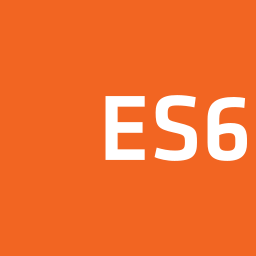
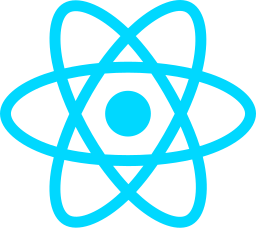
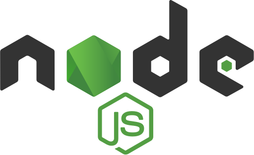
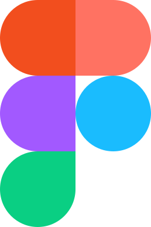
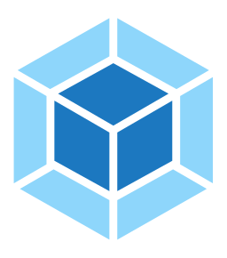

# Привет 👋

Я фронтенд-разработчик

## Технологии, которые я использую:

### Технологии для Фронтенд-разработки

  
  
  
  
  
  
  
  

### Технологии для Бэкенд-разработки

  
  
  

### Инструменты для Веб-разработки

  
  
  
  

